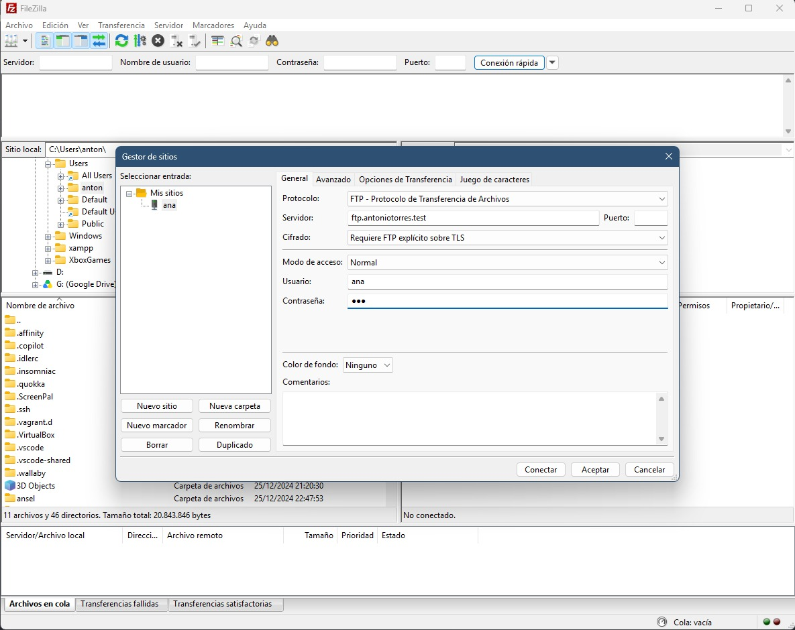
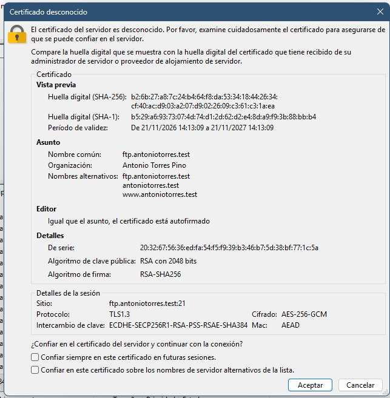
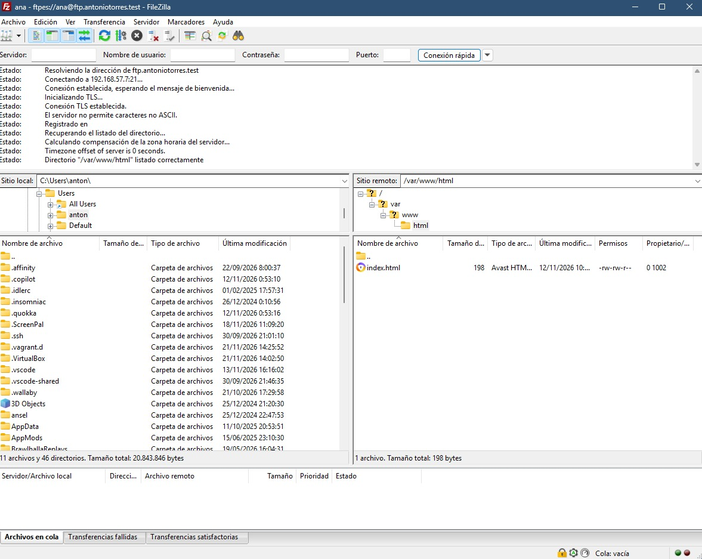
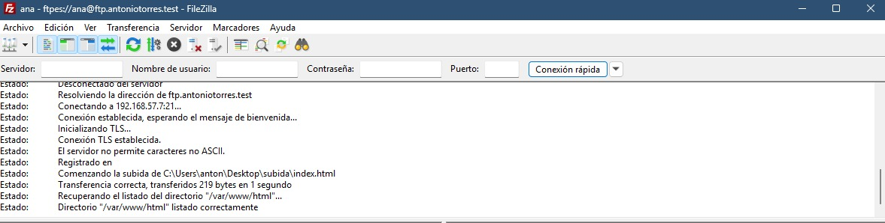
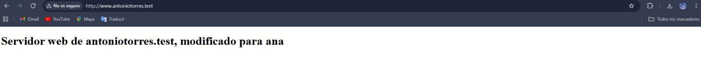
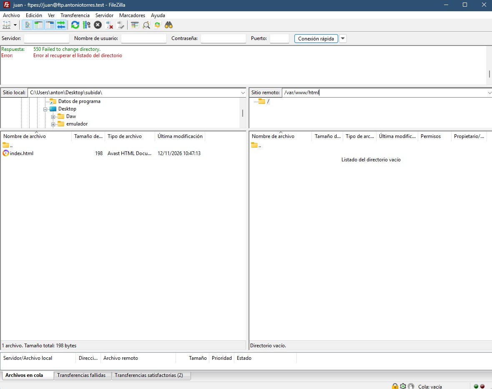

# FTP con Vagrant y Ansible

Práctica de 2º de DAW hecha por Antonio Torres Pino.
Repositorio: https://github.com/antoniotorrespino/FTP-con-Vagrant-y-Ansible

## De qué va

En esta práctica he montado tres máquinas virtuales con Vagrant y las he configurado con Ansible. Una hace de servidor DNS, otra de servidor web y FTP, y la tercera es la que uso para lanzar Ansible contra las otras dos.

El FTP va cifrado con TLS y tiene dos usuarios: `ana`, que puede subir páginas web a `/var/www/html`, y `juan`, que solo puede moverse por su directorio personal.

## Máquinas

- `dns` (192.168.57.5): servidor DNS con BIND9.
- `ansible` (192.168.57.6): desde aquí se ejecuta Ansible.
- `negocio` (192.168.57.7): Apache y vsftpd.

Los nombres `www.antoniotorres.test` y `ftp.antoniotorres.test` apuntan a `negocio` con un CNAME.

## Herramientas

Git y GitHub (con Issues y Projects para organizar las tareas), VirtualBox, Vagrant con la imagen `debian/bookworm64`, Ansible con Vault y la colección `community.crypto`, y BIND9, Apache y vsftpd en las máquinas.

## Cómo ponerlo en marcha

Hacen falta Git, VirtualBox y Vagrant instalados.

1. Clonar el repositorio:

   ```
   git clone https://github.com/antoniotorrespino/FTP-con-Vagrant-y-Ansible.git
   cd FTP-con-Vagrant-y-Ansible
   ```

2. Crear un archivo `vault_pass.txt` en la raíz con la contraseña del vault (`daw`). No está en el repositorio porque lo ignora el `.gitignore`.

3. Levantar las máquinas:

   ```
   vagrant up
   ```

4. Para que Windows resuelva los nombres, en PowerShell como administrador:

   ```
   Add-DnsClientNrptRule -Namespace ".antoniotorres.test" -NameServers "192.168.57.5"
   ```

Si hay que lanzar los playbooks a mano, entro en la máquina `ansible` con `vagrant ssh ansible` y ejecuto:

```
ansible-playbook dns/dns.yml
ansible-playbook web/web.yml
ansible-playbook ftp/ftp.yml --vault-password-file ./.vault_pass.txt
```

## Cómo lo he probado

- DNS: `vagrant ssh dns -c "bash /vagrant/dns/test.sh"`
- Web: `vagrant ssh ansible -c "bash /vagrant/web/test.sh"` y abriendo `http://www.antoniotorres.test`
- FTP: con `curl -k --ssl-reqd --user ana:ana ftp://ftp.antoniotorres.test/` y con FileZilla (las capturas están más abajo)

Los usuarios son `ana` con contraseña `ana` y `juan` con contraseña `juan`. El acceso anónimo está desactivado y las conexiones sin TLS se rechazan. Las contraseñas están en `ftp/vars/vault.yml` como hashes, cifrado con Ansible Vault.

Un aviso: si el PC se suspende con las máquinas encendidas, el reloj de las VMs se descuadra y `apt` falla. Lo mejor es apagarlas con `vagrant halt`.

## Capturas

Conexión de `ana` con FileZilla usando el nombre del servidor y FTP explícito sobre TLS:



Certificado autofirmado que muestra al conectar:



`ana` entra en `/var/www/html`:



Subida del `index.html` modificado:



La página web ya con el cambio:



`juan` no puede salir de su directorio (da error al intentar entrar en `/var/www/html`):



## Licencia

MIT, el texto completo está en el archivo `LICENSE`.